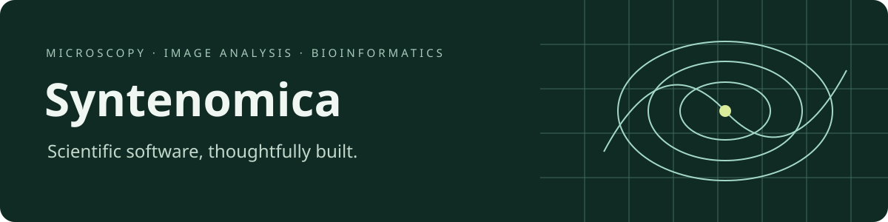

I build tools that make scientific images and data easier to explore, compare and document. My current work focuses on microscopy workflows, local image processing and protein sequence exploration.

## Projects

### Syntenomica
A microscopy workspace for reviewing focal planes, comparing recordings, computing focus composites and documenting observations.

- **Android:** the original mobile application.
- **Ubuntu:** a native desktop preview with local projects, manual measurements and relative focus Relief.
- Application source repositories are currently private.

### [PRISM · Protein Intelligence Suite](https://github.com/Syntenomica/PRISM)
A Flask/Biopython application for exploring sequence-derived protein descriptors, comparing variants and exporting reports. The public repository includes setup instructions and the limits of its heuristic interpretations.

## How I approach the work

Clear interfaces, traceable processing and honest scientific limits. A visualization should help explain the data without implying more precision than the method supports.

**Working with:** Python · Kotlin · Qt/PySide6 · OpenCV · NumPy/SciPy · ONNX Runtime · Flask · Biopython

[PRISM source](https://github.com/Syntenomica/PRISM) · [Syntenomica privacy policy](https://syntenomica.github.io/privacy/)
